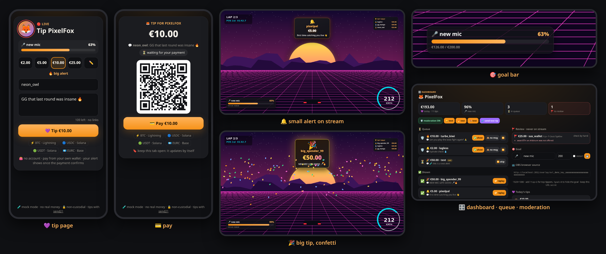
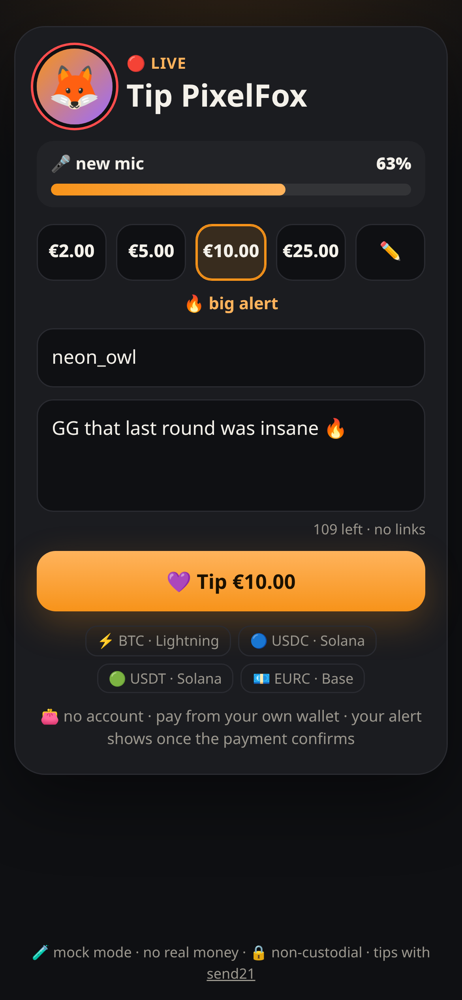
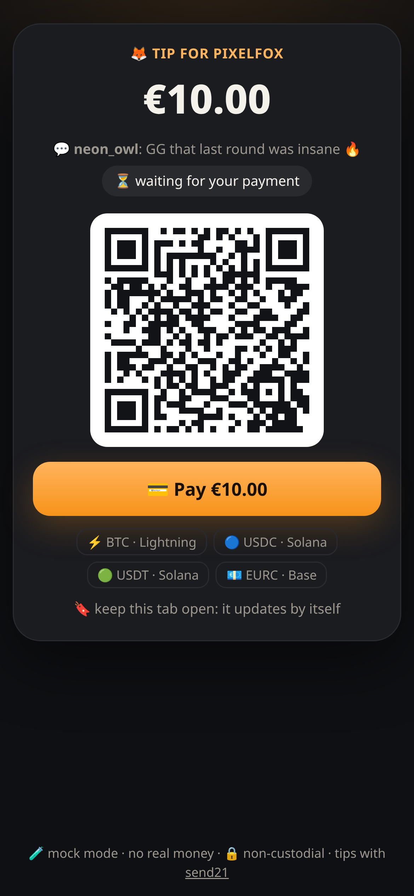
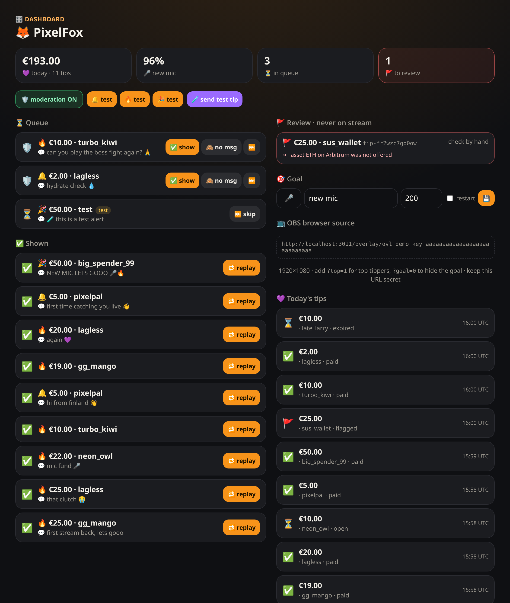
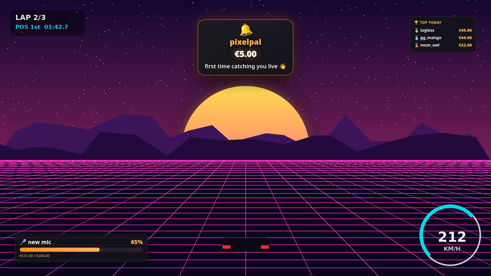
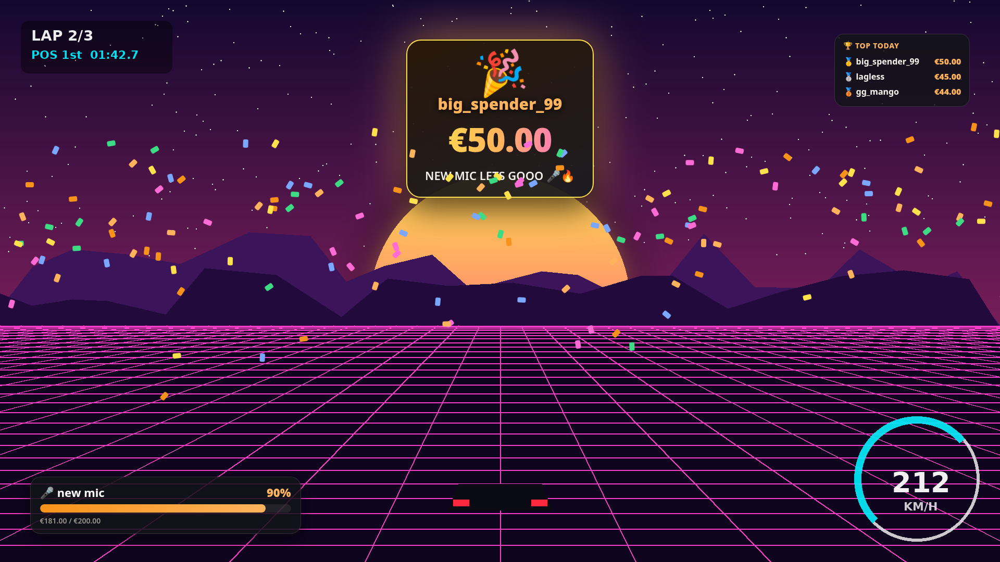
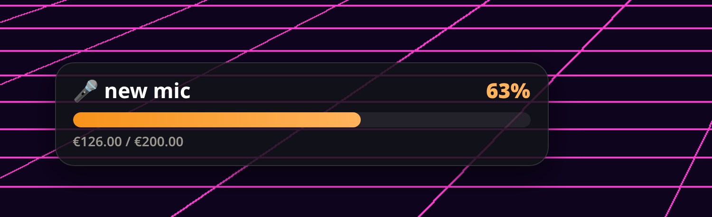
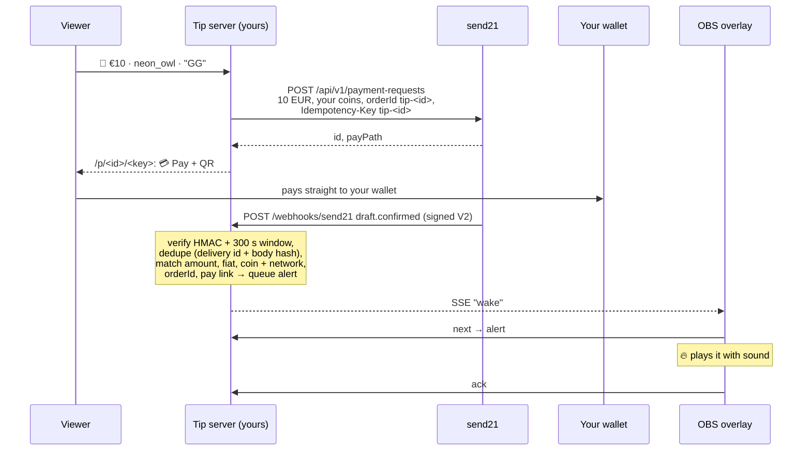

# send21 stream tips 🦊💜

**Viewers tip with crypto from their phone. Your OBS overlay plays the alert 🔔🔥🎉, once, only after the payment is confirmed.** Built on [send21](https://send21.io), crypto pay links and API for people and AI agents.

<p></p>

<sub>Mock-mode screenshots, not real payments. The overlay is transparent; the game behind it is a made-up background.</sub>

- 💜 **Tip page** `/t/<you>`: amount chips or ✏️ your own amount, a name and a short message. Each tip gets **one** send21 pay link.
- 🔔 **Alerts** in three sizes: 🔔 small, 🔥 medium, 🎉 big with confetti and sound. One at a time, and **each one exactly once**, even if OBS reloads.
- 🎯 **Goal bar** ("🎤 new mic 63%") and an optional 🏆 top tippers box.
- 🎛️ **Dashboard:** the queue with ⏭️ skip and 🔁 replay, 🛡️ moderation (hold alerts until you OK them), the goal, 🧪 test alerts, today's tips, and a 🚩 review list that never reaches the stream.
- 🧹 **Clean chat:** messages are length-limited, links are refused, a short word list is masked with ♥, and everything is escaped.
- 🔒 No viewer account, no email. You get paid straight to your own wallet.

| | | |
| --- | --- | --- |
|  💜 tip page |  💳 pay |  🎛️ dashboard |
|  🔔 small alert |  🎉 big tip |  🎯 goal bar |

## Quickstart

1. **Try it now, no keys:** run `npm install && npm run dev`.
   - 🎛️ Open http://localhost:3000/dashboard/demo and hit 🧪 **send test tip**: a fake wallet pays a mock pay link and a signed webhook comes back, just like the real thing.
   - 📺 Open the overlay URL from the dashboard in a second tab to watch the alert. Or tip yourself at http://localhost:3000/t/pixelfox and pay on the mock page: ✅ pay, ⚠️ 5% short then ↩️ decline, 🚩 wrong coin, or ⌛ expire.
   - In mock mode the overlay key and the dashboard token are random on each start unless you set `OVERLAY_KEY` and `STREAMER_TOKEN`.
2. **send21 key.** On [send21.io/api-keys](https://send21.io/api-keys), create a key with `drafts:write`. Add `webhooks:manage` for step 4.
3. **Configure.** Run `cp .env.example .env` and fill in:
   - the key and `PUBLIC_URL`
   - your own receiving addresses (`PAY_LIGHTNING`, `PAY_OPTIONS`)
   - `STREAMER_TOKEN` (dashboard login) and `OVERLAY_KEY` (the secret in the overlay URL), two different random values
   - 🔐 **Approve your receiving addresses in send21.** New send21 accounts (created on or after 20 Oct 2026) only accept receiving addresses the owner approved, including Lightning addresses. Add them in the send21 app, or propose one from an agent (MCP `propose_receiving_address`), then sign in and approve it with a passkey or authenticator code. No API key can approve an address. Older accounts can opt in under Settings.
4. **Webhook.** Put the server behind your own HTTPS address, for example a reverse proxy with a free Let's Encrypt certificate and `TRUST_PROXY=1`. Then run `npm run webhook:register` and paste the printed `SEND21_WEBHOOK_SECRET` into `.env`.
5. **You.** Run `cp stream.example.json stream.json` and set your id, name, emoji, currency, amount chips, min and max, tier limits (`tiers.medium`, `tiers.big`) and the starting goal. Then `npm run build && npm start`.
6. **OBS.** Add a **Browser** source with the overlay URL from the dashboard, 1920×1080. Tick "Control audio via OBS" if you want the sound on its own fader. Options: `?top=1` shows top tippers, `?goal=0` hides the goal, `?sound=0` mutes.

## How it works

💜 **Tip.** The server checks the amount and the text, stores the tip and creates **one** send21 payment request for it:

- priced in your currency, payable in your coins
- `orderId` is `tip-<id>`, which is also the `Idempotency-Key`, with `reuseOpenForOrder: true`

The viewer lands on `/p/<id>/<key>`, a secret URL (only the key's hash is stored), and pays with 💳 or the QR. **Nothing shows on stream until send21 says the payment is confirmed.**



**Exactly once.** The overlay asks for the next alert, and the server **leases** it to that overlay for 30 s. The overlay plays the whole alert and then **acks** it; only the ack marks it ✅ shown. Reload OBS mid-alert and the same alert comes back once the lease ends, instead of being lost or doubled. Acks are idempotent. The overlay gets a push over SSE and also polls every few seconds, so a dropped connection only delays an alert.

| Webhook | Tip | Alert? |
| --- | --- | --- |
| `draft.seen` | 👀 seen | no |
| `draft.confirmed`, matches the tip | ✅ paid | **yes** (held first if 🛡️ moderation is on) |
| `draft.confirmed`, does **not** match | 🚩 flagged | **never**, it goes to review |
| `draft.amount_mismatch` | ⚠️ review (accept or decline on send21) | no |
| → `draft.mismatch_accepted`, then `draft.confirmed` | 👍 → ✅ | yes, on `draft.confirmed` |
| → `draft.mismatch_rejected` | ↩️ declined | no |
| → `draft.mismatch_unresolved` | 🚩 unresolved | no |
| `payment_request.expired`, `draft.expired` | ⌛ expired | no |

A payment that arrives after ⌛ or ↩️ is still paid (marked *late*), and its alert is **held** for you instead of popping up out of nowhere. An unpaid link is marked ⌛ locally 15 minutes after send21's expiry.

**🛡️ Moderation.** When it's on, every new alert waits in the queue as 🛡️ held. ✅ show it, 🙈 show it without the message, or ⏭️ skip it. ⏭️ also works on an alert that is playing right now; 🔁 replay puts a shown alert back at the end of the queue.

**🧹 Text filter** (`src/filter.ts`). Names and messages are trimmed, stripped of invisible and bidi characters and length-limited (`nameMax`, `messageMax`). Links in any disguise (`evil.com`, `discord.gg`, `(dot)`) and `<` `>` are refused. A short starter list of swear words is masked with ♥, whole words only so "Scunthorpe" survives; add your own with `BLOCKED_WORDS`. No word list is perfect, which is why 🛡️ moderation exists. Output is always HTML-escaped and the overlay uses `textContent`, so the filter is not the XSS defence.

**🎯 Goal and 🏆 top tippers.** The goal counts paid tips since the goal started; change it or ↺ restart it from the dashboard. Top tippers are today's paid tips (UTC day) grouped by name, `anon` left out. 🧪 Test alerts never count.

**⚡ Lightning.** send21 fetches an invoice from your Lightning address. It confirms the payment when your wallet provider supports **LUD-21**. Without LUD-21 the money still reaches you, but no alert plays on its own. See [Lightning](https://send21.io/docs/lightning).

**Fees.** One small send21 fee per paid tip (0.49% on small payments, at least $0.01), never taken from the payment. See [pricing](https://send21.io/pricing). On €1 tips the minimum fee is a bigger share, so pick your `min` with that in mind.

## Troubleshooting

- **422 `address_not_approved`:** a receiving address isn't approved in your send21 account, so nothing was created. Sign in to send21, approve the address (passkey or authenticator code), then try again.

## Security notes

- **Signature V2 only.** Every delivery is checked with `X-Send21-Signature-V2`: an HMAC-SHA256 over `<t>.<delivery id>.<raw body>`, compared in constant time. Deliveries more than **300 s** old or dated in the future are refused. A bad signature gets `401` and nothing is stored.
- **Dedupe on both sides.**
  - send21 dedupes on its side: retries reuse the same `X-Send21-Delivery` id, and the `Idempotency-Key` makes one tip one link.
  - The receiver must still run its own duplicate check, and this one does. A delivery id, or the same body under a new id (sha256), is applied once, and a tip that is already paid never queues a second alert.
  - The delivery record, the tip and its alert are written in one step before the `2xx`, so a restart cannot alert twice. A failed write answers `500`, so send21 retries.
- **Exact match or no alert.** A `draft.confirmed` must match the stored tip:
  - `orderId` `tip-<id>` and the pay link id
  - `status: Confirmed` and a txId
  - the fiat currency and the exact amount in cents
  - a coin **and** network that the tip offered

  Anything else is 🚩 for you to check and never shows on stream. Refunds are up to you, by hand.
- **Secret URLs.** The overlay URL holds `OVERLAY_KEY` (compared in constant time); treat it like a password and never show it on stream. Each tip status URL holds a 256-bit key; only its hash is stored. The dashboard uses an HMAC-signed cookie (`HttpOnly`, `SameSite=Strict`, path-scoped, `Secure` on https), with Origin and Fetch checks on POSTs. `/dashboard/demo` exists in mock mode only.
- **Hardened pages.**
  - Strict CSP (`'self'`, no inline script or style) and `frame-ancestors 'none'`.
  - Tiny body limits; tips and logins are rate-limited per IP.
  - The API key is never logged and cannot move funds.
- **Data.** Everything lives in one JSON file (`DATA_FILE`, mode 600), written atomically. Played alerts are kept a week for 🔁 replay. For several processes, use SQLite or Postgres.

## Develop

```bash
npm run check   # typecheck + lint + tests: signature, dedupe, restart, exact match, lease + ack, moderation, filter, goal, dashboard auth
```

API reference: [send21.io/docs](https://send21.io/docs) · [quickstart](https://send21.io/docs/quickstart) · [webhooks](https://send21.io/docs/webhooks) · [llms-full.txt](https://send21.io/llms-full.txt). More examples: [send21-examples](https://github.com/send21io/send21-examples).

Questions: [info@send21.io](mailto:info@send21.io). License: [MIT](LICENSE).
